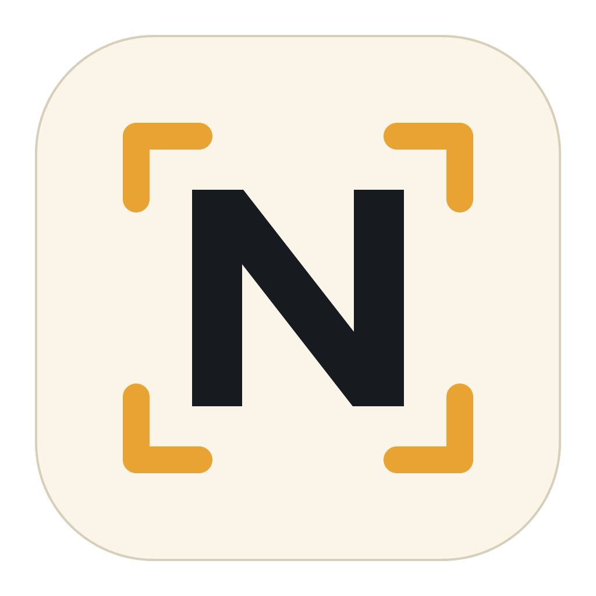
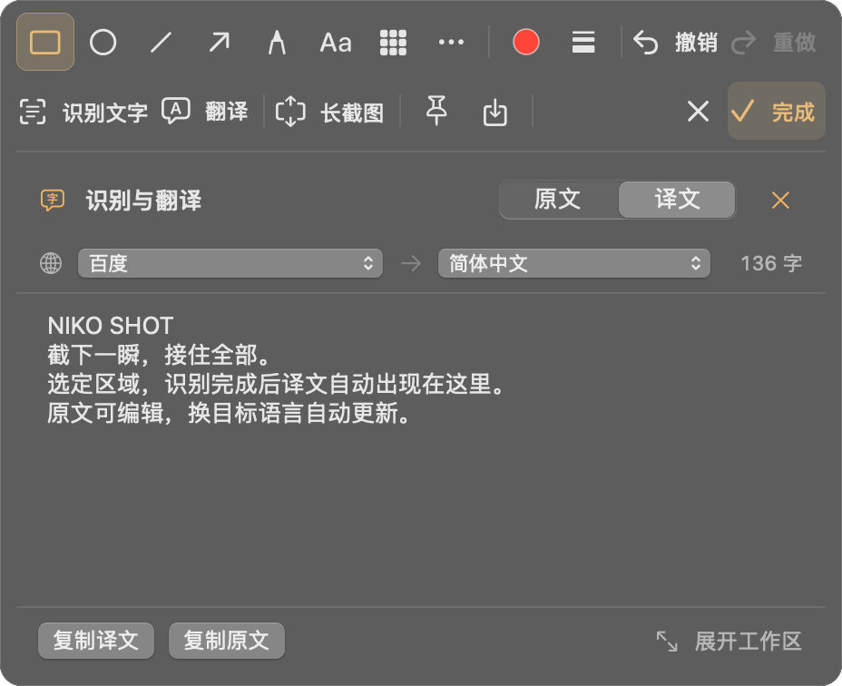
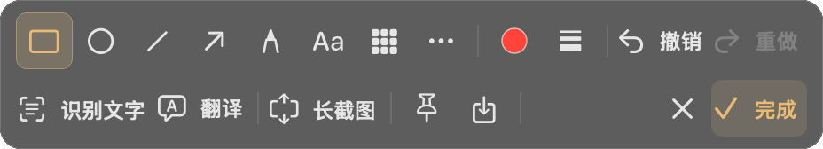
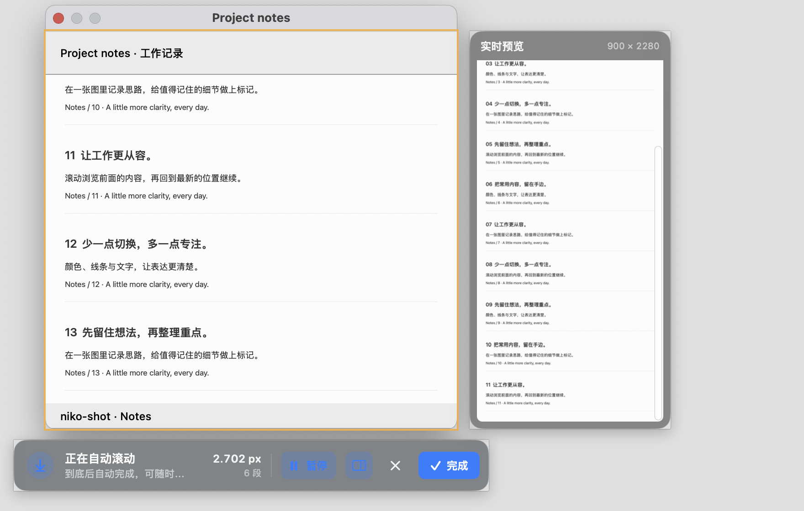
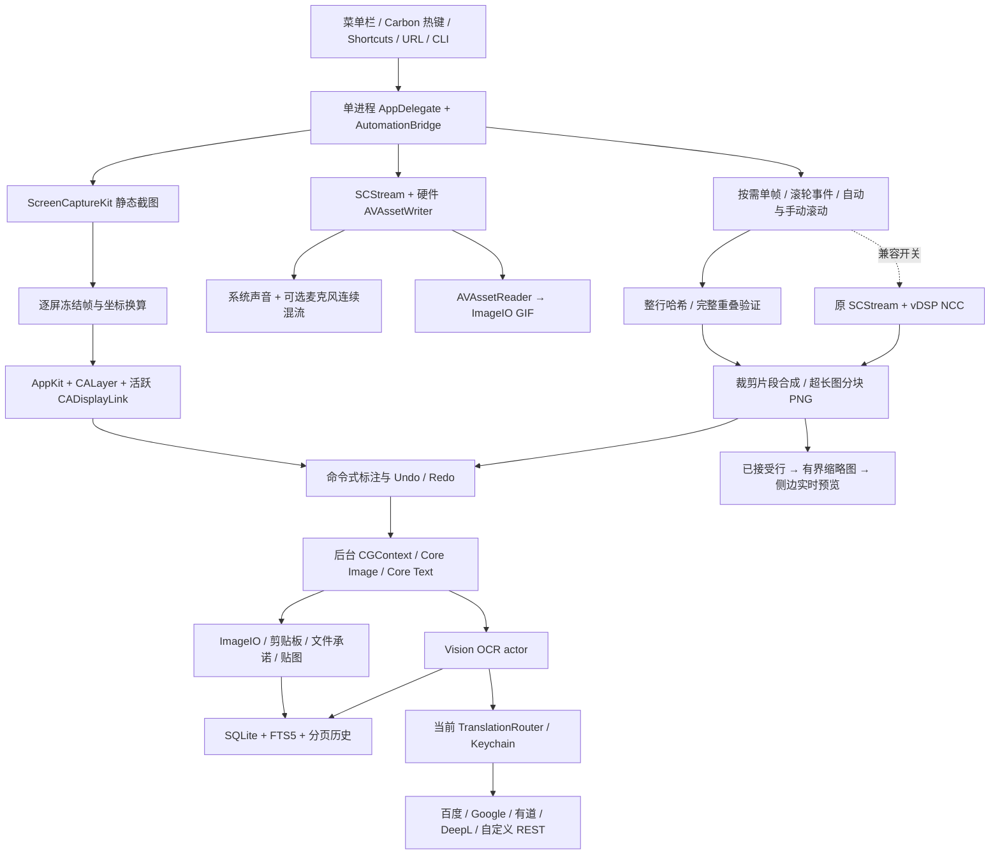

<h1 align="center">
  &nbsp; niko-shot
</h1>

<p align="center">
  <b>截下一瞬，接住全部。</b><br>
  原生 Mac 截图、标注、长截图、OCR、翻译与录屏工具。
</p>

<p align="center">
  <a href="https://github.com/baogutang/niko-shot/actions/workflows/build.yml"></a>
  
  
  <a href="https://github.com/baogutang/niko-shot/releases/latest"></a>
</p>

<p align="center">
  <strong><a href="https://github.com/baogutang/niko-shot/releases/latest">下载 Mac 版</a></strong>
  &nbsp;·&nbsp;
  <strong><a href="https://baogutang.github.io/niko-shot/">访问官网</a></strong>
  &nbsp;·&nbsp;
  <a href="#开发与构建">从源码构建</a>
  &nbsp;·&nbsp;
  <a href="https://baogutang.github.io/niko-shot/guide.html">翻译服务申请</a>
</p>

<p align="center">
  <a href="https://baogutang.github.io/niko-shot/"></a>
</p>
<p align="center"><sub>文字跟着截图走 · 识别完成，译文自动接上；切换原文可编辑，选择目标语言自动更新。</sub></p>

## 一张截图，动作接着走

- **截取画面**：区域、窗口、全屏，延时截图或重复上次选区。高亮选择窗口，也能循环选择同一点的层叠窗口。
- **标注重点**：矩形、椭圆、直线、箭头、画笔、文字和马赛克直接可点，颜色、线宽与带文字的撤销、重做固定在第一排；「更多」展开其余标注工具，全部 12 种工具随时可用。右侧「✓ 完成」并复制；也能保存 PNG / JPEG / HEIF / TIFF，或把图片拖到目标应用。
- **继续长截图**：直接选窗口并自行滚动；已有辅助功能授权时自动定位主滚动区域，避开窗口工具栏、固定底栏与侧栏。手动框选沿用你选定的范围。选区始终留在实时屏幕上，周围轻微变暗。滚动时按需抓取当前窗口画面，旁边的原生半透明预览跟随长图增长，也能切换全图查看。也可从截图底部 **「长截图」** 沿用当前选区。停止滚动后自动收取最后一帧，再继续标注、复制或保存；历史与导入图片会引导重新选择屏幕内容。
- **提取文字，自动接上翻译**：配置当前服务后，识别完成即在截图工具栏下方显示译文，默认自动检测 → 简体中文；未配置时直接显示可编辑、复制的原文。换语言或服务自动更新，编辑原文时停止输入后再请求；结果可直接复制。需要处理全文时展开完整工作区，逐段勾选、编辑与复制。Vision 识别中、英、日混排，百度、Google、有道、DeepL 与自定义 REST 独立配置。
- **录下过程**：区域、窗口或屏幕录制，暂停后继续。系统音频、可选麦克风与摄像头画中画，导出 MP4 或 GIF。
- **把常用内容留在手边**：贴图置顶、调透明度，历史支持 OCR 搜索、重新编辑和拖出。全局快捷键、Shortcuts、URL 与 CLI 接入同一个常驻进程。

<p align="center"></p>
<p align="center"><sub>第一排标注与撤销重做，第二排识别文字、翻译、长截图与输出；右侧对号完成并复制，结果接在工具栏下。</sub></p>

<p align="center"></p>
<p align="center"><sub>选区一直在，长图接着长 · 边滚边看，也能切换全图检查整体效果。</sub></p>

## 下载与安装

[**下载最新版本**](https://github.com/baogutang/niko-shot/releases/latest) · [官网按芯片下载](https://baogutang.github.io/niko-shot/#download) · [更新记录](https://github.com/baogutang/niko-shot/releases)

支持 **macOS 14 或更新版本**。M 芯片与 Intel 分别提供独立安装包，在苹果菜单「关于本机」中可确认芯片或处理器类型。

| 你的 Mac | DMG 安装包 | ZIP 安装包 |
|---|---|---|
| M 芯片 · Apple Silicon | [niko-shot-arm64.dmg](https://github.com/baogutang/niko-shot/releases/latest/download/niko-shot-arm64.dmg) | [niko-shot-arm64.zip](https://github.com/baogutang/niko-shot/releases/latest/download/niko-shot-arm64.zip) |
| Intel | [niko-shot-x86_64.dmg](https://github.com/baogutang/niko-shot/releases/latest/download/niko-shot-x86_64.dmg) | [niko-shot-x86_64.zip](https://github.com/baogutang/niko-shot/releases/latest/download/niko-shot-x86_64.zip) |

1. 下载对应芯片的 DMG，将 **niko-shot.app** 拖入「应用程序」。也可解压 ZIP 后复制应用。
2. 打开 niko-shot，按首次向导开启「屏幕录制」权限。
3. 按 **⇧⌘A** 框选截图，点击右侧 **✓** 或按 **Enter** 完成并复制。
4. 长截图时选定窗口并自行滚动，框内保留实时内容，旁边预览随长图增长。停下后自动收取最后一帧，继续标注、复制或保存。预览可切换全图查看，点击「回到最新」恢复跟随。

首次打开若收到系统提示，可按 [Apple 的打开说明](https://support.apple.com/zh-cn/102445)在「系统设置 → 隐私与安全性」中处理。每个 Release 提供安装包、[SHA256 校验文件](https://github.com/baogutang/niko-shot/releases/latest/download/SHA256SUMS)与[构建信息](https://github.com/baogutang/niko-shot/releases/latest/download/release-info.json)。

### 只在功能需要时授权

| 权限 | 触发条件 |
|---|---|
| 屏幕录制 | 截图、OCR 选区、长截图、录屏；主动检查和引导，拒绝时报明确错误 |
| 辅助功能 | 仅自动滚动派发事件；拒绝后自动使用手动长截图，并说明原因 |
| 麦克风/摄像头 | 用户开启对应录制选项时 |
| 通知 | 用户选择接收完成提醒时 |
| 输入监控 | 永不申请；Carbon 热键无需此权限 |

设置链接和手动刷新都由用户操作；没有后台轮询权限状态。点击完成通知可在 Finder 中定位文件，临时预览已移除时打开截图历史。

## 本地处理，以及由你选择的翻译

截图、标注、录屏与 Vision OCR 在 Mac 上处理；历史图片和 OCR 搜索索引保存在本机。翻译会把需要翻译的文字发送给你选择的服务或自托管实例。**截图文字卡片与完整 OCR 工作区共用自动翻译设置，默认开启，可在设置关闭。**识别完成后自动显示译文，修改语言、服务或原文后更新；关闭自动翻译时使用「翻译」按钮。

API 密钥保存在系统 Keychain；设置不会回显已保存的明文，复制与删除由你操作。五类服务彼此平级，失败时显示原服务的错误，不自动重试或转向另一家。CLI 只广播操作元数据，OCR 和译文正文通过仅当前用户可读的临时文件传递。

应用不嵌入或调用通用 LLM，也不加载本地语言模型；第三方服务内部模型由服务方决定，客户端不能保证其服务器架构。相关依据见[翻译配置与协议说明](docs/TRANSLATION.md)。

### 申请并连接翻译服务

打开「设置 → OCR 与翻译 → 翻译服务」，选择配置分段，再进入「申请与接入指南」。每家都按 **申请服务 → 填入凭据 → 测试连接** 展示官方入口。保存后测试连接，再显式设为当前服务；切换配置分段会保留未保存输入。

| 服务 | 需要准备 | 申请前确认 |
|---|---|---|
| 百度 | APP ID、密钥 | 开通通用文本翻译服务 |
| Google Cloud Translation Basic v2 | API Key | 同一项目启用 Translation API 与计费 |
| 有道智云 | 应用 ID（appKey）、应用密钥 | 创建并绑定文本翻译 API 应用 |
| DeepL API | 完整 Auth Key | 当前新申请为 Developer / Growth / Enterprise API；普通翻译订阅与 API 不同 |
| 自定义 REST | 服务模板；引用 $KEY 时填 API Key / Token | 彩云申请 API Token；LibreTranslate 官方托管购买密钥，自托管可免密 |

**[查看完整官方申请步骤、控制台链接与模板示例 →](docs/TRANSLATION.md)**

官方资料核对日期：2026-10-13。已有 DeepL Free / Pro 密钥按官方端点规则使用；服务开通与计费状态以各家控制台为准。

<a id="快捷键"></a>

<details>
<summary>完整快捷键表与截图、标注、录屏操作</summary>

## 键盘优先，也保留直接操作

以下是默认全局快捷键，均可在设置中录制修改；冲突会行内提示并提供候选组合。

| 功能 | 默认快捷键 |
|---|---|
| 区域截图 | Shift+Command+A |
| 窗口截图 | Shift+Command+W |
| 全屏截图 | Shift+Command+F |
| 重复上次区域 | Shift+Command+R |
| 录屏 | Shift+Command+V |
| OCR | Shift+Command+O |
| 滚动长截图 | Shift+Command+L |
| 贴图库 | Shift+Command+P |
| 全部贴图显隐 | Option+Command+T |

这些组合键均可在设置中录制修改，冲突会行内标红并提供候选键。会话内：Esc 取消，Command+Z/Shift+Command+Z 撤销/重做，1–9 切工具，`[` / `]` 循环全部 12 个工具。标注中空格从画布中心开始，再按空格完成；方向键移动端点 1 个原图像素，Shift 为 10 像素；文字和便签按空格打开原生输入框。长截图 HUD 支持 Command+Return 结束、Command+R 重试、Shift+Command+M 改为手动。

原生窗口使用标准「文件」与「窗口」菜单：Command+W 关闭当前窗口，Command+M 最小化。历史列表支持单击选择、上下键切换和双击编辑；OCR 区块使用 AppKit 原生文字编辑器，支持选文、粘贴、撤销和重做。

**更多截图、标注、录屏与长截图操作**

- 截图先冻结每块屏幕，再在冻结帧上选区。窗口悬停高亮，Space 循环同一点的层叠窗口；Shift 锁比例，Option 从中心缩放，方向键按目标屏像素微调。U 切换尺寸单位，P 打开预设或输入宽高，Option+C 复制色值。
- Tab 进入标注。矩形、椭圆、直线、箭头、画笔、马赛克、模糊、文字、便签、高亮、放大镜、序号均由可序列化命令驱动，可撤销、重做和重新选择裁剪区域。历史大图自动适应窗口宽度，保存保留原始像素尺寸。
- 点击右侧对号或按 Enter 完成并复制；Command+S 选择 PNG、JPEG、HEIF 或 TIFF 保存。剪贴板同时提供 PNG、TIFF 和文件地址；预览支持文件承诺拖拽。输出设置可调整文件名模板、JPEG 质量和递增序号。
- 贴图可置顶、双指缩放、滚轮改变透明度、双击关闭；全部贴图显隐有独立快捷键。历史分页加载，支持删除、编辑、拖出、重新 OCR 和中文全文搜索。
- OCR 支持中文、英文、日文混排，准确/快速模式及可配置语言。系统快速模型不支持所选中文时自动使用准确识别；启用日文的混排会复核原生候选，代价是额外识别时间和内存。逐块勾选、编辑、复制，可合并段落、整理换行和转换中文标点。历史自动 OCR 默认开启，并在后台回填 SQLite/FTS5。
- OCR 工作区的原文和译文并排显示，截图文字卡片可切换原文与译文。当前服务配置完成后，默认识别完成自动翻译；未配置时显示原文，不发送请求。换服务或语言后自动更新；原文编辑停止 400 毫秒后更新，连续输入会合并为一次请求。五家服务平级，失败保留该家的错误，由用户重试，不自动切换到其他服务。关闭自动翻译后保留手动按钮。
- 录屏支持区域、窗口和屏幕，指定延时后有三秒倒计时；HUD 提供暂停、继续、停止、取消和可选摄像头画中画。系统声音默认开启，麦克风按需；默认 HEVC，也可选择 H.264。GIF 使用 AVAssetReader 与 ImageIO，支持宽度、抽帧、预估体积和全局 256 色调色板。
- 长截图选择窗口后直接滚动，透明选区与侧边预览持续保留。停下 60 毫秒后自动收取最后一帧并进入标注编辑器，也能随时点击「完成」。固定头部、尾部只保留一次；正文的空白边距仍保留。瞬时撕裂或没有重叠的帧直接丢弃，已截内容保留；向上回看不会追加重复内容。自动模式从细小步进渐进加速，可暂停和继续，不再等待多次稳定画面。纯白尾部不会仅因画面相同就误判到底。窗口在当前屏幕内移动时继续跟随，改变尺寸、屏幕或缩放时提示重新选择。设置 → 截图保留旧版引擎兼容开关，默认关闭；普通截图和录屏不受影响。


</details>

## Shortcuts、URL 与命令行

在系统 Shortcuts 中可使用区域截图、窗口截图、开始录制、滚动截图和最近 OCR 五个动作。需要键盘或脚本入口时，也可使用 URL Scheme 和同一主应用的 CLI。

<details>
<summary>查看动作参数、URL 和 CLI 示例</summary>

Shortcuts 中提供 `CaptureRegionIntent`、`CaptureWindowIntent`、`StartRecordingIntent`、`ScrollCaptureIntent`、`LastOCRTextIntent`。前四个支持延时、输出路径和自动 OCR；窗口可指定 ID，录制可指定 MP4/GIF。未指定目标区域时仍使用原生选择界面。开始录制动作返回计划输出路径，HUD 停止后才完成该文件；自动化指定输出路径时直接保存。

URL 入口：

```text
niko-shot://capture?type=region&delay=2
niko-shot://record?format=gif
niko-shot://scroll
```

主二进制也可直接作为 CLI；可选执行 `scripts/install-cli.sh /Applications/niko-shot.app` 将 `niko` 安装至 `/usr/local/bin`。脚本不会代替用户取得管理员权限。

```sh
niko capture --region --output ~/Desktop/s.png
niko ocr --clipboard
niko translate --to zh
niko --help
```

`ocr --clipboard` 会先选择截图，再识别并将文字写入剪贴板；`translate` 读取剪贴板文字，通过当前服务翻译并写回剪贴板。CLI 不启动另一套捕获引擎，而是向常驻主进程发送元数据请求，完成或取消后退出。OCR/译文响应通过仅用户可读的临时文件传递，通知中不广播正文或密钥。

</details>

<a id="开发与构建"></a>

## 从源码构建

使用完整 Xcode 与 XcodeGen。工程使用 Xcode 26.3 / Swift 6.2.x，应用部署目标为 macOS 14。

从干净检出进入项目目录后，两步生成并构建：

```sh
xcodegen generate
xcodebuild -scheme niko-shot -configuration Debug build
```

<details>
<summary>测试与 Release 构建</summary>

可重复执行完整干净构建与测试：

```sh
scripts/verify.sh B9
```

Release 按架构独立构建应用，不把测试运行时注入的 Apple 框架计入安装包：

```sh
xcodebuild -scheme niko-shot -configuration Release -derivedDataPath build/Release-arm64 ARCHS=arm64 ONLY_ACTIVE_ARCH=NO build
xcodebuild -scheme niko-shot -configuration Release -derivedDataPath build/Release-x86_64 ARCHS=x86_64 ONLY_ACTIVE_ARCH=NO build
scripts/ci-package.sh build/Release-arm64/Build/Products/Release/niko-shot.app build/local-ci-packages arm64
scripts/ci-package.sh build/Release-x86_64/Build/Products/Release/niko-shot.app build/local-ci-packages x86_64
scripts/release-manifest.py build/local-ci-packages
scripts/release-manifest.py build/local-ci-packages --verify
```

两份应用各自只包含指定架构。打包脚本校验版本、源码提交与文件完整性，并生成构建信息及 SHA256 校验文件。GitHub Actions 在版本标签推送后完成测试、打包和发布；维护流程见[发布文档](docs/RELEASES.md)。

工程由 [project.yml](project.yml) 管理。使用 Swift 6 严格并发、AppKit / SwiftUI 与系统框架，运行时不依赖 WebView、ffmpeg 或第三方二进制。

</details>

## 原生架构

<details>
<summary>原生架构与数据流</summary>



AppKit 与原生配置停留在 MainActor；像素渲染、识别、拼接、编码在 worker/actor 中处理。静态截图确认时裁剪原冻结帧，不二次截屏；进入标注后释放全屏 backing。录屏专用队列负责 CMSampleBuffer 的生命周期；跨队列音频只使用自有 PCM，不跨 actor 传带状态的缓冲。空闲时没有显示刷新驱动、捕获轮询或录制计时器。

</details>

## 文档与反馈

| 想了解 | 入口 |
|---|---|
| 产品与下载 | [官网](https://baogutang.github.io/niko-shot/) · [最新 Release](https://github.com/baogutang/niko-shot/releases/latest) |
| 服务申请、密钥与模板 | [翻译配置指南](docs/TRANSLATION.md) |
| 发布流程 | [发布文档](docs/RELEASES.md) |
| 自动构建 | [GitHub Actions](https://github.com/baogutang/niko-shot/actions/workflows/build.yml) |
| 问题与建议 | [GitHub Issues](https://github.com/baogutang/niko-shot/issues) |

反馈时请提供应用版本或构建信息、macOS 版本、复现步骤与实际结果；多屏问题附屏幕布局及缩放设置。分享截图或日志前，请移除个人内容与服务凭据。
