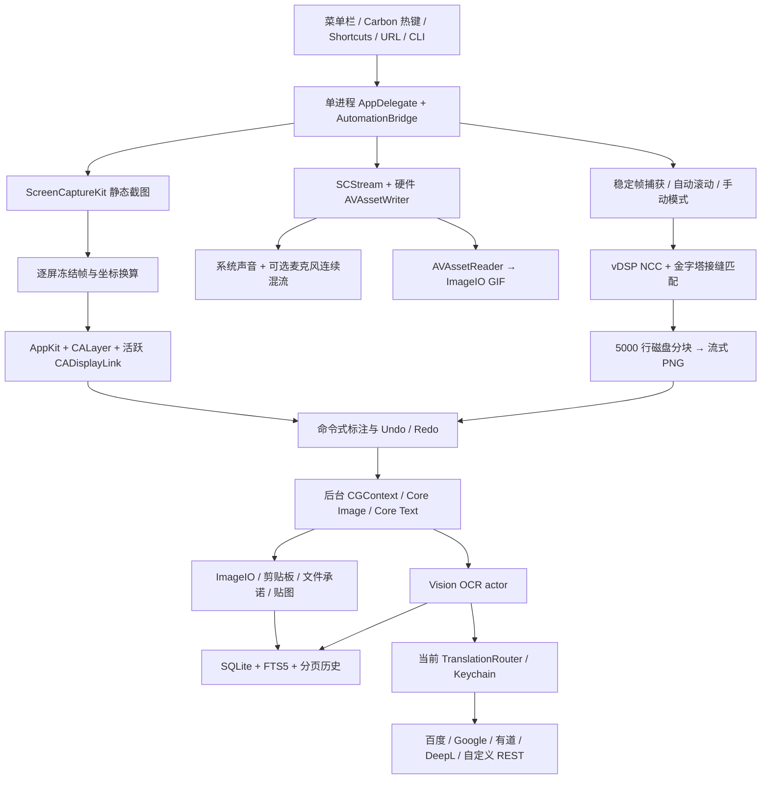

# niko-shot

原生 macOS 菜单栏截图、录屏、OCR、翻译和滚动长截图工具。唯一功能规格是 [PROMPT.md](PROMPT.md)；B0–B9 均为必交付，阶段顺序用于构建依赖。Swift 6 严格并发，最低 macOS 14，运行时只使用系统框架，没有 WebView、ffmpeg、登录 Helper 或第三方二进制。

当前为可构建、可运行的开发候选。界面改版后的 157 项本机回归测试通过，干净 Git 检出的构建与测试也通过；§9 的冷启动和使用后 RSS 基线预算未达标，账号、外设及 Developer ID 分发验收未全部完成，整体 DoD 尚未通过。

## 构建与运行

安装 Xcode 和 XcodeGen 后，从项目目录执行两步：

```sh
xcodegen generate
xcodebuild -scheme niko-shot -configuration Debug build
```

打开构建产物 `niko-shot.app`。开发构建可以使用 ad hoc 签名。可重复的完整干净构建与测试：

```sh
scripts/verify.sh B9
```

Release 体积应使用纯 `build` 产物测量，不能把 `build test` 注入的 Apple 测试框架算入安装包：

```sh
xcodebuild -scheme niko-shot -configuration Release -derivedDataPath build/Release build
open build/Release/Build/Products/Release/niko-shot.app
```

Developer ID 分发需要有效证书和已存入 Keychain 的公证配置。设置 `DEVELOPER_ID_APPLICATION`、`NOTARY_PROFILE` 后执行 `scripts/distribute.sh`，脚本会 archive、校验签名、提交公证、staple，并生成 ZIP 和 SHA256。没有证书时，ad hoc 构建不能代替已签名、公证的分发包。

## 使用

从菜单栏开始，或使用下表的全局快捷键。首次使用有三步向导：欢迎、屏幕录制授权、试截一张。设置中的「通用」可重看向导、打开权限设置及启用登录启动。登录启动使用 `SMAppService.mainApp`，常驻只有主应用一个进程。

新版菜单以区域截图为主要入口，窗口／全屏与其他工具分组，底部展示最近三次截图。设置保留九个分类，OCR 与翻译分为两个子页；OCR 工作区左侧编辑与勾选文字，右侧并排核对原文和译文。录屏、GIF 和长截图设置将主要操作固定在底部。界面使用系统字体、颜色与原生材质，支持浅色和深色；应用图标采用静态原生资源。改版范围和验证记录见 [界面改版记录](docs/UI-REDESIGN.md)。

- 截图先冻结每块屏幕，再在冻结帧上选区。窗口悬停高亮，Space 循环同一点的层叠窗口；Shift 锁比例，Option 从中心缩放，方向键按目标屏像素微调。U 切换尺寸单位，P 打开预设或输入宽高，Option+C 复制色值。
- Tab 进入标注。矩形、椭圆、直线、箭头、画笔、马赛克、模糊、文字、便签、高亮、放大镜、序号均由可序列化命令驱动，可撤销、重做和重新选择裁剪区域。历史大图自动适应窗口宽度，保存保留原始像素尺寸。
- Enter 复制；Command+S 选择 PNG、JPEG、HEIF 或 TIFF 保存。剪贴板同时提供 PNG、TIFF 和文件地址；预览支持文件承诺拖拽。输出设置可调整文件名模板、JPEG 质量和递增序号。
- 贴图可置顶、双指缩放、滚轮改变透明度、双击关闭；全部贴图显隐有独立快捷键。历史分页加载，支持删除、编辑、拖出、重新 OCR 和中文全文搜索。
- OCR 支持中文、英文、日文混排，准确/快速模式及可配置语言。系统快速模型不支持所选中文时自动使用准确识别；启用日文的混排会复核原生候选，代价是额外识别时间和内存。逐块勾选、编辑、复制，可合并段落、整理换行和转换中文标点。历史自动 OCR 默认开启，并在后台回填 SQLite/FTS5。
- OCR 的原文和译文并排显示，选择当前服务与语言对后翻译。五家服务平级，失败保留该家的错误，不重试或切换到其他服务。可关闭 OCR 完成后的自动翻译。
- 录屏支持区域、窗口和屏幕，指定延时后有三秒倒计时；HUD 提供暂停、继续、停止、取消和可选摄像头画中画。系统声音默认开启，麦克风按需；默认 HEVC，也可选择 H.264。GIF 使用 AVAssetReader 与 ImageIO，支持宽度、抽帧、预估体积和全局 256 色调色板。
- 长截图选区后确认模式，默认自动滚动。拖动或输入固定头尾忽略区；捕获及处理完成、画面稳定后才继续滚动。低相关度或重复纹理会暂停，可确认重叠像素、重试或切换手动。手动模式等待用户滚动，不会因停留而误判到底。长图进入同一个标注编辑器，再复制或保存。

| 功能 | 默认快捷键 |
|---|---|
| 区域截图 | Shift+Command+A |
| 窗口截图 | Shift+Command+W |
| 全屏截图 | Shift+Command+F |
| 重复上次区域 | Shift+Command+R |
| 录屏 | Shift+Command+V |
| OCR | Shift+Command+O |
| 滚动长截图 | Shift+Command+L |
| 贴图库 | Shift+Command+P |
| 全部贴图显隐 | Option+Command+T |

这些组合键均可在设置中录制修改，冲突会行内标红并提供候选键。会话内：Esc 取消，Command+Z/Shift+Command+Z 撤销/重做，1–9 切工具，`[` / `]` 循环全部 12 个工具。标注中空格从画布中心开始，再按空格完成；方向键移动端点 1 个原图像素，Shift 为 10 像素；文字和便签按空格打开原生输入框。长截图 HUD 支持 Command+Return 结束、Command+R 重试、Shift+Command+M 改为手动。

## 五家翻译配置

完整申请、配置、错误处理和自定义模板说明见 [五家翻译配置指南](docs/TRANSLATION.md)，官方资料核验日期为 2026-10-13。在设置「OCR 与翻译 → 翻译服务」选择要配置的卡片，点击「申请与接入指南」查看申请、填入凭据、测试连接三个阶段及官方跳转链接。保存后测试连接，并显式设为当前服务；切换配置卡片会保留未保存输入。OCR 窗口也可直接打开指南或进入服务配置。

| 服务 | 必需配置 | 原生接口 |
|---|---|---|
| 百度 | appid、密钥 | UTF-8 原文 MD5 签名，表单 POST，多行结果合并 |
| Google Cloud Translation v2 | API Key，启用 API 与计费 | JSON POST，自动检测可省略 source |
| 有道智云 | appKey、appSecret | v3 SHA256，按官方 Python3 的 Unicode 码点进行前 10/长度/后 10 截断 |
| DeepL | Auth Key | `:fx` 自动选择 Free endpoint，JSON POST |
| 自定义 REST | 名称、Method/URL、Headers、Body、响应路径；模板引用 `$KEY` 时需要 Key | JSON/表单占位符和数组路径；内置彩云、LibreTranslate 模板，支持免密自托管实例 |

密钥只进入系统 Keychain，service 为 `com.n1ko.niko-shot`；设置不会回显已保存的明文，复制和删除由用户操作。缓存按服务、实例、凭据、语言对和原文区分，五分钟有效，最多 128 条；修改凭据不会命中旧缓存。网络超时 15 秒，原始服务错误码保留。

客户端未嵌入或调用 LLM。第三方服务内部使用何种模型由服务商决定，客户端不能保证 DeepL 等服务端架构完全不含大模型；详情和官方资料链接见配置指南。

## 自动化

Shortcuts 中提供 `CaptureRegionIntent`、`CaptureWindowIntent`、`StartRecordingIntent`、`ScrollCaptureIntent`、`LastOCRTextIntent`。前四个支持延时、输出路径和自动 OCR；窗口可指定 ID，录制可指定 MP4/GIF。未指定目标区域时仍使用原生选择界面。开始录制动作返回计划输出路径，HUD 停止后才完成该文件；自动化指定输出路径时直接保存。

URL 入口：

```text
niko-shot://capture?type=region&delay=2
niko-shot://record?format=gif
niko-shot://scroll
```

主二进制也可直接作为 CLI；可选执行 `scripts/install-cli.sh /Applications/niko-shot.app` 将 `niko` 安装至 `/usr/local/bin`。脚本不会代替用户取得管理员权限。

```sh
niko capture --region --output ~/Desktop/s.png
niko ocr --clipboard
niko translate --to zh
niko --help
```

`ocr --clipboard` 会先选择截图，再识别并将文字写入剪贴板；`translate` 读取剪贴板文字，通过当前服务翻译并写回剪贴板。CLI 不启动另一套捕获引擎，而是向常驻主进程发送元数据请求，完成或取消后退出。OCR/译文响应通过仅用户可读的临时文件传递，通知中不广播正文或密钥。

## 权限

| 权限 | 触发条件 |
|---|---|
| 屏幕录制 | 截图、OCR 选区、长截图、录屏；主动检查和引导，拒绝时报明确错误 |
| 辅助功能 | 仅自动滚动派发事件；拒绝后自动使用手动长截图，并说明原因 |
| 麦克风/摄像头 | 用户开启对应录制选项时 |
| 通知 | 用户选择接收完成提醒时 |
| 输入监控 | 永不申请；Carbon 热键无需此权限 |

设置链接和手动刷新都由用户操作；没有后台轮询权限状态。点击完成通知可在 Finder 中定位文件，临时预览已移除时打开截图历史。

## 架构



AppKit 与原生配置停留在 MainActor；像素渲染、识别、拼接、编码在 worker/actor 中处理。静态截图确认时裁剪原冻结帧，不二次截屏；进入标注后释放全屏 backing。录屏专用队列负责 CMSampleBuffer 的生命周期；跨队列音频只使用自有 PCM，不跨 actor 传带状态的缓冲。空闲时没有显示刷新驱动、捕获轮询或录制计时器。

## 性能与验收证据

构建、合成/原生媒体测试、实际授权设备测试、账号连通和分发签名分开记录，详见 [验收记录](docs/ACCEPTANCE.md)。测试通过不能替代真实屏幕、麦克风、摄像头或服务账号验收。

当前机器：Apple M1 Max，macOS 15.7.7，Xcode 26.3 / Swift 6.2.4；唯一显示器为 5120×2880、75Hz 的 Kuycon G27P。

下表实机指标来自改版前 B9 候选 `f6cb924`，应用体积行已更新为界面改版构建。界面改版尚未重新完成整套实机性能采样；保留此前未达标项，不能据此宣布新版满足全部性能预算。

| 指标 | 预算 | 当前实测 / 状态 |
|---|---|---|
| 冷启动至菜单可用 | <400ms | 延迟初始化后的最终候选 414.24ms，**这次未达标**；前两候选 427.74ms、415.30ms；旧候选三个独立启动为 348.87、353.98、381.22ms，保留全部原始结果 |
| 空闲 RSS | <40MB | 最终候选两小时 fresh idle 峰值 32,400 KiB；使用标注、OCR、贴图后关闭全部窗口并等待 15 秒，仍为 334,064 KiB（326.2MiB），**使用后未达标** |
| 空闲 CPU | 0% | 最终候选两小时 121 次 external ps 采样全部 0%；尚不是 Instruments Time Sampler 验收 |
| 热键至冻结覆盖窗 | <120ms，4K <200ms | 真实 5K 首次区域覆盖准备 403.91ms；非物理热键、非 4K，不宣称预算通过 |
| 框选交互 | ProMotion 120fps | 75Hz 屏幕实际 CADisplayLink 74.82fps；120Hz 需对应设备 |
| 常驻应用进程 | 1 | 重复启动及两个 CLI 同时冷启动后均只有 1 个常驻 PID；两个 CLI 返回相同 OCR 文本 |
| Release 安装体积 | <15MB | 界面改版纯 Release universal 应用 7,232 KiB（7.41MB），ad hoc 开发 ZIP 3,389,663 字节（3.39MB）；没有第三方运行时二进制 |
| 1080p30 录屏 CPU | <8% | 真实 SCStream 1920×1080 HEVC/AAC，短 top 样本 4.2%；静态桌面 VFR 平均 23.31fps，持续动态 30fps 预算未验证 |
| 10000px 长图拼接峰值 | <500MB | 1920×10000 编码约 42MB RSS；含完整 PNG 解码校验的独立进程约 366MB，需区分编码与测试校验 |
| 退出后资源 | 0 窗口 / 监听 / 计时器 | 最终候选完成录屏设置取消、标注、OCR、贴图后正常退出，全部资源计数 0；PID 与采样器均已退出 |
| 两小时空闲 | RSS 无增长 | 最终候选 2026-10-13 00:03:16–02:03:16，完整 7200.01 秒、121 次采样；RSS 从 32,352 降至 30,512 KiB，净变化 −1,840 KiB |

`scripts/measure-idle.py` 用外部采样器记录真实进程的 MenuReady 时间、RSS 和 CPU，不向应用加入轮询。默认运行两小时，原始 JSON、终止统计与 display-link 时间戳存于 `build/evidence`。可另外使用 `xcrun xctrace` 的 Time Profiler、Allocations 和 App Launch 模板记录原始 Instruments trace。

改版前 B9 候选完成干净构建与 149 项测试。界面改版后的本机回归为 157 项、0 failures、0 编译警告，新增官方接入导航检查及免密 REST、编码占位符认证和 OPTIONS 的真实本机 HTTP 验证。测试覆盖原生图片／音视频编码、Vision 混排、模板签名、跨进程自动化、窗口及任务生命周期；实际账号和外设验收范围保持独立。

同一构建已复制至 `~/Applications/niko-shot.app`，主二进制哈希保持一致。原生登录启动开关实际完成启用及注销，最终恢复关闭；没有执行注销登录或重启系统。正常启动安装副本并重启 Shortcuts 后，系统发现全部五个正式动作，最近 OCR 动作在应用运行时和退出后均实际返回公开测试文字；前四个动作的完整捕获仍需对应权限和实机验收。

## 已知边界与后续

- 系统 ImageIO 没有 WebP 编码，当前输出提供 PNG、JPEG、HEIF、TIFF 和原生 GIF。这是规格中明确的已知限制。
- macOS 14 功能通过部署目标和严格类型检查覆盖；macOS 14 真机、双屏异 DPI、拔插屏、全屏 Spaces、VoiceOver 和 ProMotion 120Hz 仍必须分别实测。
- 有效翻译账号和 Developer ID 证书由使用/分发环境提供，不能用 mock 响应或 ad hoc 签名宣称账号连通或公证成功。
- 使用后空闲 RSS <40MB 目前未达标。独立原生 Vision 混排探针释放图片和请求后 15 秒，默认设备仍为 207.03MiB；GPU、CPU、Neural Engine 分别为 278.12、374.44、238.92MiB，均未达到预算。未找到经过验证的系统模型缓存卸载办法，不能用重启进程或 physical footprint 替换 RSS 指标。
- 后续增量可以增加更多自定义 REST 预设、标注样式预设和可复用快捷指令示例。现有 B0–B9 功能保持交付范围，不以路线图替代当前验收。

系统 API 依据：[App Intents](https://developer.apple.com/documentation/appintents/appintent)、[AppKit macOS 14 显示刷新接口](https://developer.apple.com/videos/play/wwdc2023/10054/)、[SMAppService](https://developer.apple.com/documentation/servicemanagement/smappservice)。
