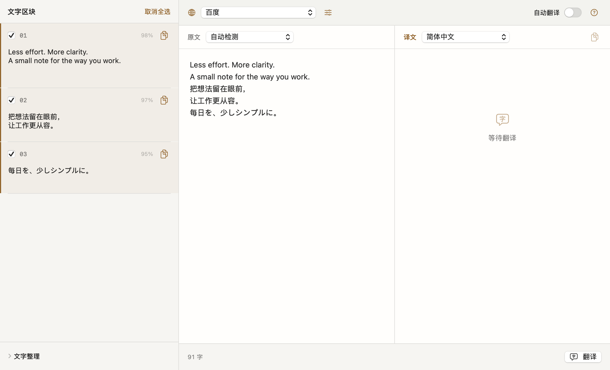
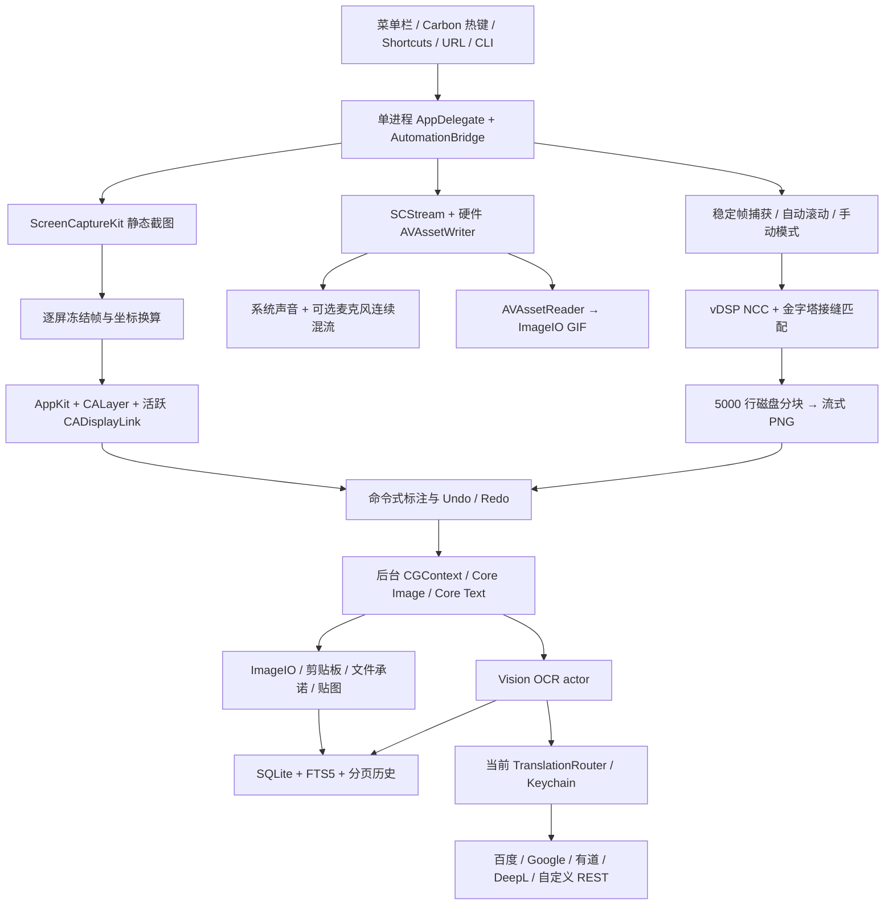

<h1 align="center">
  &nbsp; niko-shot
</h1>

<p align="center">
  <b>截下一瞬，接住全部。</b><br>
  原生 Mac 截图、标注、长截图、OCR、翻译与录屏工具。
</p>

<p align="center">
  <a href="https://github.com/baogutang/niko-shot/actions/workflows/build.yml"></a>
  
  
  <a href="https://github.com/baogutang/niko-shot/releases/tag/nightly"></a>
</p>

<p align="center">
  <strong><a href="https://github.com/baogutang/niko-shot/releases/tag/nightly">下载 Mac 版</a></strong>
  &nbsp;·&nbsp;
  <strong><a href="https://baogutang.github.io/niko-shot/">官网与交互体验</a></strong>
  &nbsp;·&nbsp;
  <a href="#开发与构建">从源码构建</a>
  &nbsp;·&nbsp;
  <a href="https://baogutang.github.io/niko-shot/guide.html">翻译服务申请</a>
</p>

<p align="center">
  <a href="https://baogutang.github.io/niko-shot/"></a>
</p>
<p align="center"><sub>当前源码的原生离屏预览，使用公开合成数据。窗口未激活，部分控件呈非活动外观；预览不替代真实交互验收。</sub></p>

> **当前源码版本 0.1.1，为开发候选。** 本机 176 项回归测试通过；下载指向最近成功的 GitHub 候选，并非所有新提交都已打包。Nightly 使用 ad hoc 签名，尚未完成 Developer ID 分发与公证；冷启动及使用后内存预算未达标，真实账号、外设与部分实机交互仍有待验收，整体 DoD 尚未通过。完整依据见[验收记录](docs/ACCEPTANCE.md)。

本次更新统一 NIKO 标志与浅深色界面，重做官网和 README；截图底部直接继续长截图，并修复重新选区提示的取消卡住问题。

## 一张截图，动作接着走

- **截取画面**：区域、窗口、全屏，延时截图或重复上次选区。高亮选择窗口，也能循环选择同一点的层叠窗口。
- **标注重点**：箭头、文字、便签、马赛克等 12 种工具，随时撤销与重做。复制、保存 PNG / JPEG / HEIF / TIFF，或把图片拖到目标应用。
- **继续长截图**：截图底部点击 **「长截图」**，沿用当前屏幕选区。自动或手动滚动，拼好后回到标注，再复制或保存；历史与导入图片会引导重新框选屏幕。
- **提取文字，再接上翻译**：Vision 识别中、英、日混排，逐段勾选、编辑和复制。百度、Google、有道、DeepL 与自定义 REST 独立配置，原文译文并排核对。
- **录下过程**：区域、窗口或屏幕录制，暂停后继续。系统音频、可选麦克风与摄像头画中画，导出 MP4 或 GIF。
- **把常用内容留在手边**：贴图置顶、调透明度，历史支持 OCR 搜索、重新编辑和拖出。全局快捷键、Shortcuts、URL 与 CLI 接入同一个常驻进程。

<p align="center"></p>
<p align="center"><sub>原生工具栏离屏预览。官网可直接练习框选、画箭头、导出或复制图片；网页不会读取屏幕或发起 OCR、翻译请求。</sub></p>

## 下载与安装

[**下载 Mac 版：DMG / ZIP**](https://github.com/baogutang/niko-shot/releases/tag/nightly) · [全部发布说明](https://github.com/baogutang/niko-shot/releases)

1. 确认系统为 macOS 14 或更新版本。Universal 包同时包含 Apple Silicon 与 Intel 架构。
2. 打开 DMG，将 niko-shot.app 拖入「应用程序」；或解压 ZIP 后把应用放入「应用程序」或你自己的 Applications 目录。
3. 打开应用，在菜单栏进入首次向导：欢迎 → 屏幕录制授权 → 试截一张。默认按 **⇧⌘A** 开始区域截图。
4. 需要翻译时，再按下文配置自己的服务；录屏麦克风、摄像头与自动滚动权限按需开启。

GitHub Actions 在 main 通过构建与测试后更新 **Nightly 导航页**，下载始终指向最近成功的候选。其中的 DMG、ZIP、SHA256SUMS 与 release-info.json 链接指向同一个独立、不可变的候选发布。文件不会在下载期间被滚动覆盖，可核对哈希与完整源码提交；[Actions](https://github.com/baogutang/niko-shot/actions/workflows/build.yml)保留自动构建记录。下载不会自动重装或替换本机已有应用。

当前候选未完成 Developer ID 签名与 Apple 公证，macOS 可能阻止首次打开。请先核对发布来源与文件哈希，再按 [Apple 的安全打开说明](https://support.apple.com/zh-cn/102445)决定是否允许打开此次应用。ad hoc 签名完整性与测试通过不代表 Apple 已公证。

### 只在功能需要时授权

| 权限 | 触发条件 |
|---|---|
| 屏幕录制 | 截图、OCR 选区、长截图、录屏；主动检查和引导，拒绝时报明确错误 |
| 辅助功能 | 仅自动滚动派发事件；拒绝后自动使用手动长截图，并说明原因 |
| 麦克风/摄像头 | 用户开启对应录制选项时 |
| 通知 | 用户选择接收完成提醒时 |
| 输入监控 | 永不申请；Carbon 热键无需此权限 |

设置链接和手动刷新都由用户操作；没有后台轮询权限状态。点击完成通知可在 Finder 中定位文件，临时预览已移除时打开截图历史。

## 本地处理，以及由你选择的翻译

截图、标注、录屏与 Vision OCR 在 Mac 上处理；历史图片和 OCR 搜索索引保存在本机。翻译会把需要翻译的文字发送给你选择的服务或自托管实例。**OCR 自动翻译默认开启，可在设置关闭。**

API 密钥保存在系统 Keychain；设置不会回显已保存的明文，复制与删除由你操作。五类服务彼此平级，失败时显示原服务的错误，不自动重试或转向另一家。CLI 只广播操作元数据，OCR 和译文正文通过仅当前用户可读的临时文件传递。

应用不嵌入或调用通用 LLM，也不加载本地语言模型；第三方服务内部模型由服务方决定，客户端不能保证其服务器架构。相关依据见[翻译配置与协议说明](docs/TRANSLATION.md)。

### 申请并连接翻译服务

打开「设置 → OCR 与翻译 → 翻译服务」，选择配置分段，再进入「申请与接入指南」。每家都按 **申请服务 → 填入凭据 → 测试连接** 展示官方入口。保存后测试连接，再显式设为当前服务；切换配置分段会保留未保存输入。

| 服务 | 需要准备 | 申请前确认 |
|---|---|---|
| 百度 | APP ID、密钥 | 开通通用文本翻译服务 |
| Google Cloud Translation Basic v2 | API Key | 同一项目启用 Translation API 与计费 |
| 有道智云 | 应用 ID（appKey）、应用密钥 | 创建并绑定文本翻译 API 应用 |
| DeepL API | 完整 Auth Key | 当前新申请为 Developer / Growth / Enterprise API；普通翻译订阅与 API 不同 |
| 自定义 REST | 服务模板；引用 $KEY 时填 API Key / Token | 彩云申请 API Token；LibreTranslate 官方托管购买密钥，自托管可免密 |

**[查看完整官方申请步骤、控制台链接与模板示例 →](docs/TRANSLATION.md)**

官方资料核对日期：2026-10-13。已有 DeepL Free / Pro 密钥按官方端点规则使用；五家真实账号连通仍需分别验收。

<a id="快捷键"></a>

<details>
<summary>完整快捷键表与截图、标注、录屏操作</summary>

## 键盘优先，也保留直接操作

以下是默认全局快捷键，均可在设置中录制修改；冲突会行内提示并提供候选组合。

| 功能 | 默认快捷键 |
|---|---|
| 区域截图 | Shift+Command+A |
| 窗口截图 | Shift+Command+W |
| 全屏截图 | Shift+Command+F |
| 重复上次区域 | Shift+Command+R |
| 录屏 | Shift+Command+V |
| OCR | Shift+Command+O |
| 滚动长截图 | Shift+Command+L |
| 贴图库 | Shift+Command+P |
| 全部贴图显隐 | Option+Command+T |

这些组合键均可在设置中录制修改，冲突会行内标红并提供候选键。会话内：Esc 取消，Command+Z/Shift+Command+Z 撤销/重做，1–9 切工具，`[` / `]` 循环全部 12 个工具。标注中空格从画布中心开始，再按空格完成；方向键移动端点 1 个原图像素，Shift 为 10 像素；文字和便签按空格打开原生输入框。长截图 HUD 支持 Command+Return 结束、Command+R 重试、Shift+Command+M 改为手动。

原生窗口使用标准「文件」与「窗口」菜单：Command+W 关闭当前窗口，Command+M 最小化。历史列表支持单击选择、上下键切换和双击编辑；OCR 区块使用 AppKit 原生文字编辑器，支持选文、粘贴、撤销和重做。

**更多截图、标注、录屏与长截图操作**

- 截图先冻结每块屏幕，再在冻结帧上选区。窗口悬停高亮，Space 循环同一点的层叠窗口；Shift 锁比例，Option 从中心缩放，方向键按目标屏像素微调。U 切换尺寸单位，P 打开预设或输入宽高，Option+C 复制色值。
- Tab 进入标注。矩形、椭圆、直线、箭头、画笔、马赛克、模糊、文字、便签、高亮、放大镜、序号均由可序列化命令驱动，可撤销、重做和重新选择裁剪区域。历史大图自动适应窗口宽度，保存保留原始像素尺寸。
- Enter 复制；Command+S 选择 PNG、JPEG、HEIF 或 TIFF 保存。剪贴板同时提供 PNG、TIFF 和文件地址；预览支持文件承诺拖拽。输出设置可调整文件名模板、JPEG 质量和递增序号。
- 贴图可置顶、双指缩放、滚轮改变透明度、双击关闭；全部贴图显隐有独立快捷键。历史分页加载，支持删除、编辑、拖出、重新 OCR 和中文全文搜索。
- OCR 支持中文、英文、日文混排，准确/快速模式及可配置语言。系统快速模型不支持所选中文时自动使用准确识别；启用日文的混排会复核原生候选，代价是额外识别时间和内存。逐块勾选、编辑、复制，可合并段落、整理换行和转换中文标点。历史自动 OCR 默认开启，并在后台回填 SQLite/FTS5。
- OCR 的原文和译文并排显示，选择当前服务与语言对后翻译。五家服务平级，失败保留该家的错误，不重试或切换到其他服务。可关闭 OCR 完成后的自动翻译。
- 录屏支持区域、窗口和屏幕，指定延时后有三秒倒计时；HUD 提供暂停、继续、停止、取消和可选摄像头画中画。系统声音默认开启，麦克风按需；默认 HEVC，也可选择 H.264。GIF 使用 AVAssetReader 与 ImageIO，支持宽度、抽帧、预估体积和全局 256 色调色板。
- 长截图选区后确认模式，默认自动滚动。拖动或输入固定头尾忽略区；捕获及处理完成、画面稳定后才继续滚动。低相关度或重复纹理会暂停，可确认重叠像素、重试或切换手动。手动模式等待用户滚动，不会因停留而误判到底。长图进入同一个标注编辑器，再复制或保存。


</details>

## Shortcuts、URL 与命令行

在系统 Shortcuts 中可使用区域截图、窗口截图、开始录制、滚动截图和最近 OCR 五个动作。需要键盘或脚本入口时，也可使用 URL Scheme 和同一主应用的 CLI。

<details>
<summary>查看动作参数、URL 和 CLI 示例</summary>

Shortcuts 中提供 `CaptureRegionIntent`、`CaptureWindowIntent`、`StartRecordingIntent`、`ScrollCaptureIntent`、`LastOCRTextIntent`。前四个支持延时、输出路径和自动 OCR；窗口可指定 ID，录制可指定 MP4/GIF。未指定目标区域时仍使用原生选择界面。开始录制动作返回计划输出路径，HUD 停止后才完成该文件；自动化指定输出路径时直接保存。

URL 入口：

```text
niko-shot://capture?type=region&delay=2
niko-shot://record?format=gif
niko-shot://scroll
```

主二进制也可直接作为 CLI；可选执行 `scripts/install-cli.sh /Applications/niko-shot.app` 将 `niko` 安装至 `/usr/local/bin`。脚本不会代替用户取得管理员权限。

```sh
niko capture --region --output ~/Desktop/s.png
niko ocr --clipboard
niko translate --to zh
niko --help
```

`ocr --clipboard` 会先选择截图，再识别并将文字写入剪贴板；`translate` 读取剪贴板文字，通过当前服务翻译并写回剪贴板。CLI 不启动另一套捕获引擎，而是向常驻主进程发送元数据请求，完成或取消后退出。OCR/译文响应通过仅用户可读的临时文件传递，通知中不广播正文或密钥。

</details>

<a id="开发与构建"></a>

## 从源码构建

使用完整 Xcode 与 XcodeGen。当前本机验证环境为 Xcode 26.3 / Swift 6.2.4，应用部署目标为 macOS 14。

从干净检出进入项目目录后，两步生成并构建：

```sh
xcodegen generate
xcodebuild -scheme niko-shot -configuration Debug build
```

<details>
<summary>完整验证、Release 与正式签名分发</summary>

可重复执行完整干净构建与测试：

```sh
scripts/verify.sh B9
```

Release 仅构建应用，不把测试运行时注入的 Apple 框架计入安装包：

```sh
xcodebuild -scheme niko-shot -configuration Release -derivedDataPath build/Release build
open build/Release/Build/Products/Release/niko-shot.app
```

Developer ID 分发需要有效的 Application 证书与已存入 Keychain 的公证配置。设置 DEVELOPER_ID_APPLICATION、NOTARY_PROFILE 后执行 [scripts/distribute.sh](scripts/distribute.sh)，脚本将 archive、校验签名、公证、staple 并生成 ZIP 与 SHA256。没有证书时，开发签名不能代替正式分发。

工程由 [project.yml](project.yml) 管理；唯一功能规格为 [PROMPT.md](PROMPT.md)，B0–B9 全部保持 P0 范围。实现说明与真实验收分别记录，构建成功不等于产品验收完成。

</details>

## 架构与验收

当前实现使用 Swift 6 严格并发、AppKit / SwiftUI 与系统框架。运行时没有 WebView、ffmpeg、登录 Helper 或第三方二进制。最新本机回归 **176 项、0 failures**；真实设备、账号、分发与性能结果保持独立。

<details>
<summary>原生架构与数据流（Mermaid）</summary>



AppKit 与原生配置停留在 MainActor；像素渲染、识别、拼接、编码在 worker/actor 中处理。静态截图确认时裁剪原冻结帧，不二次截屏；进入标注后释放全屏 backing。录屏专用队列负责 CMSampleBuffer 的生命周期；跨队列音频只使用自有 PCM，不跨 actor 传带状态的缓冲。空闲时没有显示刷新驱动、捕获轮询或录制计时器。

</details>

<details>
<summary>完整性能预算、实测表与证据边界</summary>

构建、合成/原生媒体测试、实际授权设备测试、账号连通和分发签名分开记录，详见 [验收记录](docs/ACCEPTANCE.md)。测试通过不能替代真实屏幕、麦克风、摄像头或服务账号验收。

当前机器：Apple M1 Max，macOS 15.7.7，Xcode 26.3 / Swift 6.2.4；唯一显示器为 5120×2880、75Hz 的 Kuycon G27P。

下表实机指标来自改版前 B9 候选 `f6cb924`，应用体积行已更新为界面改版构建。界面改版尚未重新完成整套实机性能采样；保留此前未达标项，不能据此宣布新版满足全部性能预算。

| 指标 | 预算 | 当前实测 / 状态 |
|---|---|---|
| 冷启动至菜单可用 | <400ms | 延迟初始化后的最终候选 414.24ms，**这次未达标**；前两候选 427.74ms、415.30ms；旧候选三个独立启动为 348.87、353.98、381.22ms，保留全部原始结果 |
| 空闲 RSS | <40MB | 最终候选两小时 fresh idle 峰值 32,400 KiB；使用标注、OCR、贴图后关闭全部窗口并等待 15 秒，仍为 334,064 KiB（326.2MiB），**使用后未达标** |
| 空闲 CPU | 0% | 最终候选两小时 121 次 external ps 采样全部 0%；尚不是 Instruments Time Sampler 验收 |
| 热键至冻结覆盖窗 | <120ms，4K <200ms | 真实 5K 首次区域覆盖准备 403.91ms；非物理热键、非 4K，不宣称预算通过 |
| 框选交互 | ProMotion 120fps | 75Hz 屏幕实际 CADisplayLink 74.82fps；120Hz 需对应设备 |
| 常驻应用进程 | 1 | 重复启动及两个 CLI 同时冷启动后均只有 1 个常驻 PID；两个 CLI 返回相同 OCR 文本 |
| Release 安装体积 | <15MB | 界面改版纯 Release universal 应用 7,232 KiB（7.41MB），ad hoc 开发 ZIP 3,389,663 字节（3.39MB）；没有第三方运行时二进制 |
| 1080p30 录屏 CPU | <8% | 真实 SCStream 1920×1080 HEVC/AAC，短 top 样本 4.2%；静态桌面 VFR 平均 23.31fps，持续动态 30fps 预算未验证 |
| 10000px 长图拼接峰值 | <500MB | 1920×10000 编码约 42MB RSS；含完整 PNG 解码校验的独立进程约 366MB，需区分编码与测试校验 |
| 退出后资源 | 0 窗口 / 监听 / 计时器 | 最终候选完成录屏设置取消、标注、OCR、贴图后正常退出，全部资源计数 0；PID 与采样器均已退出 |
| 两小时空闲 | RSS 无增长 | 最终候选 2026-10-13 00:03:16–02:03:16，完整 7200.01 秒、121 次采样；RSS 从 32,352 降至 30,512 KiB，净变化 −1,840 KiB |

`scripts/measure-idle.py` 用外部采样器记录真实进程的 MenuReady 时间、RSS 和 CPU，不向应用加入轮询。默认运行两小时，原始 JSON、终止统计与 display-link 时间戳存于 `build/evidence`。可另外使用 `xcrun xctrace` 的 Time Profiler、Allocations 和 App Launch 模板记录原始 Instruments trace。

改版前 B9 候选完成干净构建与 149 项测试。界面改版、发布前安全修复与 OCR 漏行恢复后的本机回归为 176 项、0 failures；Swift 6 完整并发检查与编译警告作为错误的门禁通过。新增官方接入导航、免密 REST、编码占位符认证、OPTIONS 的真实本机 HTTP 验证，以及五类服务错误回显与编码变体的密钥脱敏回归。测试覆盖原生图片／音视频编码、Vision 混排、模板签名、跨进程自动化、窗口及任务生命周期；实际账号和外设验收范围保持独立。

改版前 B9 最终候选已复制至 `~/Applications/niko-shot.app`，主二进制哈希保持一致。原生登录启动开关实际完成启用及注销，最终恢复关闭；没有执行注销登录或重启系统。正常启动安装副本并重启 Shortcuts 后，系统发现全部五个正式动作，最近 OCR 动作在应用运行时和退出后均实际返回公开测试文字；前四个动作的完整捕获仍需对应权限和实机验收。

</details>

<details>
<summary>已知限制与尚未完成的验收</summary>

- 系统 ImageIO 没有 WebP 编码，当前输出提供 PNG、JPEG、HEIF、TIFF 和原生 GIF。这是规格中明确的已知限制。
- macOS 14 功能通过部署目标和严格类型检查覆盖；macOS 14 真机、双屏异 DPI、拔插屏、全屏 Spaces、VoiceOver 和 ProMotion 120Hz 仍必须分别实测。
- 有效翻译账号和 Developer ID 证书由使用/分发环境提供，不能用 mock 响应或 ad hoc 签名宣称账号连通或公证成功。
- 使用后空闲 RSS <40MB 目前未达标。独立原生 Vision 混排探针释放图片和请求后 15 秒，默认设备仍为 207.03MiB；GPU、CPU、Neural Engine 分别为 278.12、374.44、238.92MiB，均未达到预算。未找到经过验证的系统模型缓存卸载办法，不能用重启进程或 physical footprint 替换 RSS 指标。
- 后续增量可以增加更多自定义 REST 预设、标注样式预设和可复用快捷指令示例。现有 B0–B9 功能保持交付范围，不以路线图替代当前验收。

系统 API 依据：[App Intents](https://developer.apple.com/documentation/appintents/appintent)、[AppKit macOS 14 显示刷新接口](https://developer.apple.com/videos/play/wwdc2023/10054/)、[SMAppService](https://developer.apple.com/documentation/servicemanagement/smappservice)。

</details>

## 文档与反馈

| 想了解 | 入口 |
|---|---|
| 产品与下载 | [官网](https://baogutang.github.io/niko-shot/) · [Nightly](https://github.com/baogutang/niko-shot/releases/tag/nightly) |
| 服务申请、密钥与模板 | [翻译配置指南](docs/TRANSLATION.md) |
| 原生界面与预览依据 | [界面改版记录](docs/UI-REDESIGN.md) · [原创品牌横幅](website/assets/readme-hero.svg) |
| 已验证结果与待验收项 | [验收记录](docs/ACCEPTANCE.md) |
| 功能规格与交付范围 | [PROMPT.md](PROMPT.md) |
| 自动构建 | [GitHub Actions](https://github.com/baogutang/niko-shot/actions/workflows/build.yml) |
| 问题与建议 | [GitHub Issues](https://github.com/baogutang/niko-shot/issues) |

反馈时请提供应用版本或构建信息、macOS 版本、复现步骤与实际结果；多屏问题附屏幕布局及缩放设置。分享截图或日志前，请移除个人内容与服务凭据。
