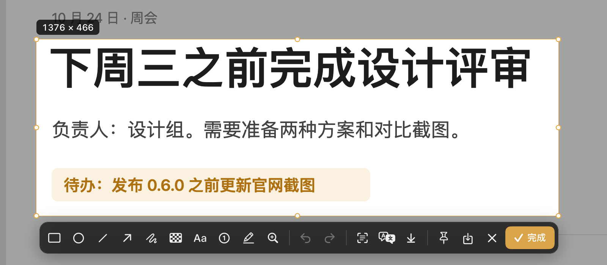

<h1 align="center">
  &nbsp; niko-shot
</h1>

<p align="center">原生 Mac 截图工具：截图、标注、长截图、文字识别、翻译和录屏。</p>

<p align="center">
  <a href="https://github.com/baogutang/niko-shot/actions/workflows/build.yml"></a>
  
  <a href="https://github.com/baogutang/niko-shot/releases/latest"></a>
</p>

<p align="center">
  <strong><a href="https://github.com/baogutang/niko-shot/releases/latest">下载</a></strong> ·
  <a href="https://baogutang.github.io/niko-shot/">官网</a> ·
  <a href="https://baogutang.github.io/niko-shot/guide.html">翻译服务接入</a> ·
  <a href="#从源码构建">从源码构建</a>
</p>

<p align="center">
  
</p>

## 功能

- **截图**：区域、窗口、全屏，可延时或重复上次选区。放大镜显示像素网格、坐标和色值。
- **标注**：矩形、椭圆、箭头、画笔、马赛克、模糊、文字、便签、高亮、放大镜和序号，都可以撤销和重新编辑。
- **复制即可粘贴**：点 ✓ 或按 Return，图片立刻进剪贴板。右下角的缩略图可以拖出文件、继续编辑或贴到屏幕。也可以在「设置 → 截图」里打开自动保存，每张截图同时存进指定文件夹。
- **长截图**：选好窗口或区域后自己滚动，或让它自动滚动。固定的顶栏和底栏只保留一份。
- **文字识别和翻译**：Vision 在本机识别中、英、日文。翻译可接百度、Google、有道、DeepL 或自定义 REST 服务。
- **录屏**：录区域、窗口或整个屏幕，可录系统声音、麦克风和摄像头画中画，导出 MP4 或 GIF。
- **贴图和历史**：贴图置顶显示。历史记录可以按识别出的文字搜索。

## 安装

支持 macOS 14 及以上。按芯片下载（在苹果菜单 → 关于本机中查看）：

| Mac | DMG | ZIP |
|---|---|---|
| Apple 芯片 | [niko-shot-arm64.dmg](https://github.com/baogutang/niko-shot/releases/latest/download/niko-shot-arm64.dmg) | [niko-shot-arm64.zip](https://github.com/baogutang/niko-shot/releases/latest/download/niko-shot-arm64.zip) |
| Intel | [niko-shot-x86_64.dmg](https://github.com/baogutang/niko-shot/releases/latest/download/niko-shot-x86_64.dmg) | [niko-shot-x86_64.zip](https://github.com/baogutang/niko-shot/releases/latest/download/niko-shot-x86_64.zip) |

1. 把 niko-shot.app 拖进「应用程序」，然后打开它。
2. 在欢迎窗口里允许「屏幕录制」，按提示重新打开一次。
3. 按 **⇧⌘A** 框选，按 **Return** 复制。

首次打开如果被系统拦下，参考 [Apple 的说明](https://support.apple.com/zh-cn/102445)。

升级不需要重新授权。正式版一直用同一张 NIKO 证书签名，macOS 按这张证书记住授权。项目没有 Apple 开发者账号，所以安装包未经公证。每个 Release 都附有 [SHA256](https://github.com/baogutang/niko-shot/releases/latest/download/SHA256SUMS) 和[构建信息](https://github.com/baogutang/niko-shot/releases/latest/download/release-info.json)。

| 权限 | 什么时候需要 |
|---|---|
| 屏幕录制 | 截图、识别、长截图、录屏 |
| 辅助功能 | 长截图自动滚动（可选） |
| 麦克风 / 摄像头 | 录屏时打开对应选项 |

niko-shot 不申请输入监控权限。

## 快捷键

新安装只设置一个全局快捷键：**⇧⌘A 区域截图**。其他功能在菜单栏图标里，需要的话可以到「设置 → 快捷键」自己指定。和其他应用冲突时，选中快捷键按 Delete 或点 ✕ 即可移除。从旧版本升级的用户会保留原有的快捷键。

截图时：

| 按键 | 作用 |
|---|---|
| Return | 完成并复制 |
| Esc | 取消 |
| Space | 选窗口时在重叠的窗口间切换 |
| Tab | 在调整选区和标注之间切换 |
| 1–9 | 选择标注工具 |
| ⌘Z / ⇧⌘Z | 撤销 / 重做 |
| ⌘S | 另存为 |
| 方向键 | 移动 1 像素，按住 Shift 移动 10 像素 |
| U | 切换像素 / 点 |

## 翻译

截图、标注、录屏和文字识别都在本机完成。只有翻译会把文字发给你选择的服务。API 密钥保存在系统钥匙串里。

在「设置 → 翻译」中选择服务，点「申请与接入指南」查看每家的申请步骤。详见[翻译配置说明](docs/TRANSLATION.md)。

## 自动化

快捷指令、URL Scheme 和命令行都由正在运行的 niko-shot 处理。

```text
niko-shot://capture?type=region&delay=2
niko-shot://record?format=gif
niko-shot://scroll
```

URL 只能打开需要你亲手操作的界面（框选、长截图、录屏设置），不能静默截图，也不能指定保存位置。没有指定输出路径的录屏保存到桌面。

```sh
scripts/install-cli.sh /Applications/niko-shot.app   # 安装 niko 命令
niko capture --region --output ~/Desktop/s.png
niko ocr --clipboard
niko translate --to zh
```

命令行直接截全屏、按窗口 ID 截图或读取最近识别的文字时不会出现任何界面，所以默认关闭。需要时到「设置 → 通用」打开「允许命令行静默截图」。

## 从源码构建

需要 Xcode 26 和 [XcodeGen](https://github.com/yonaskolb/XcodeGen)。

```sh
xcodegen generate
xcodebuild -scheme niko-shot -configuration Debug build
scripts/verify.sh B9     # 干净构建并运行全部测试
```

推送 `vX.Y.Z` 标签后，GitHub Actions 会分别构建 Apple 芯片和 Intel 两个版本并发布 Release。详见[发布流程](docs/RELEASES.md)。

## 反馈

在 [GitHub Issues](https://github.com/baogutang/niko-shot/issues) 提交，写明版本、macOS 版本和复现步骤。分享截图前请去掉个人信息和密钥。
